<p align="center">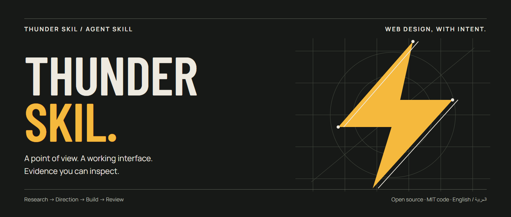</p>

<p align="center">
  <a href="https://github.com/qwzx4893-stack/thunder-Skil/actions/workflows/ci.yml"></a>
  <a href="https://github.com/qwzx4893-stack/thunder-Skil/releases"></a>
  <a href="LICENSE"></a>
  <a href="README.md"></a>
</p>

<p align="center"><strong>مهارة لتصميم واجهات مرتبطة بموضوعها، وسلوك مفيد، ومراجعة يمكن فحصها.</strong><br><a href="README.md">English</a> · <a href="docs/benchmarks/README.md">نتائج التحقق</a> · <a href="docs/research.md">المصادر والمنهج</a></p>

**Thunder Skil** تساعد الوكيل على تحويل مهمة الزائر ومحتوى المشروع وأصوله إلى قرارات تصميم وتنفيذ. لا تفرض شكلًا واحدًا على موقع حرفي ولوحة تشغيل ومرجع يطلب المستخدم نسخه بدقة.

الإصدار **0.6.1**. اسم الاستدعاء الداخلي بقي `immersive-web-studio` للحفاظ على التوافق. لا تحتاج التعليمات توكنًا أو خدمة مدفوعة أو حزمة برمجية لتعمل.

[تحديث الصيانة: إصلاح المراجع وتركيز النوافذ والأدلة الحالية](docs/fixes/README.md). هذا إصلاح للمثال الموجود، وليس اختبار تصميم جديدًا.

| ابدأ التنفيذ | شاهد النتيجة | افهم المنهج | استكشف المصادر |
|:---|:---|:---|:---|
| [تنزيل المهارة ↗](https://github.com/qwzx4893-stack/thunder-Skil/releases/latest) | [المثال والنقد والإصلاحات ↗](docs/expressive/README.md) | [التعليمات الأساسية ↗](SKILL.md) | [البحث والمراجع ↗](docs/research.md) |

## اختبار مركّز: A World Away

تجربة أرشيفية عن Apollo 11 بثماني صور حقيقية من NASA، وفيلم مع ترجمة نصية، ورحلة من ثلاثة فصول، وموشن جرافيك تخطيطي أصلي، وعارض صور يعمل. **حالة واحدة مركّزة، راجعها الوكيل الذي نفّذها بنفسه وأصلح أسباب النقد في المهارة.** [المنهج والنتائج وحدودها ←](docs/expressive/README.md)

[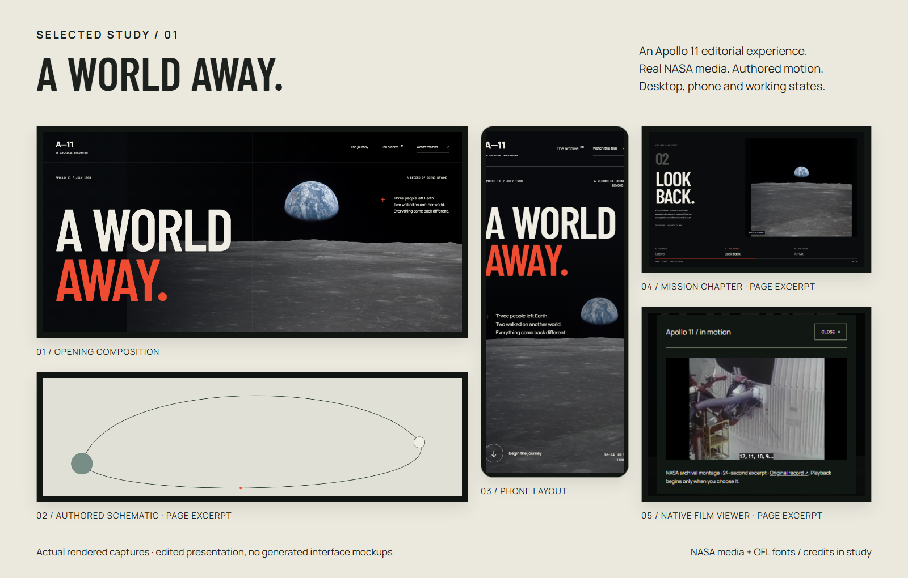](docs/expressive/README.md)

<p align="center"><sub>لقطات من التنفيذ الفعلي · أصول NASA · الحاسوب والهاتف وحالات التفاعل · <a href="docs/expressive/apollo/ASSETS.md">المصادر والحقوق</a></sub></p>

[الهاتف](docs/expressive/apollo/evidence/mobile.png) · [فصول الرحلة](docs/expressive/apollo/evidence/desktop-chapter-1.png) · [الموشن جرافيك](docs/expressive/apollo/evidence/desktop-motion-graphic.png) · [عارض الصور](docs/expressive/apollo/evidence/mobile-viewer.png) · [الفيلم](docs/expressive/apollo/evidence/mobile-film.png) · [التشغيل](docs/expressive/apollo/index.html) · [النقد والإصلاحات](docs/expressive/README.md) · [مصادر الأصول](docs/expressive/apollo/ASSETS.md)

للتجربة الكاملة شغّل `node scripts/serve-example.mjs docs/expressive/apollo` وافتح الرابط المحلي المطبوع. لا تحتاج عملية بناء أو أصولًا تُحمّل من الشبكة. الأمثلة البسيطة السابقة أدناه محفوظة كتاريخ للتطوير، ولا تُقدّم كدليل على مستوى مواقع الجوائز.

[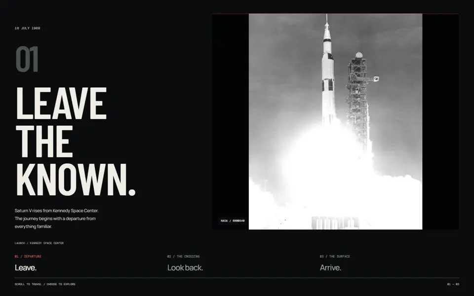](docs/expressive/apollo/evidence/motion.webp)

معاينة حركة مأخوذة من الصفحة الفعلية؛ ليست قياسًا لمعدل الإطارات أو الأداء.

<details>
<summary><strong>تشغيل التجربة الكاملة محليًا</strong></summary>

```sh
node scripts/serve-example.mjs docs/expressive/apollo
```

افتح الرابط المحلي المطبوع لتجربة الفيلم والترجمة وفلترة الأرشيف والتنقل بين الصور بالكيبورد. عارض الشفرة في GitHub لا يشغّل HTML.

</details>

## معرض التصاميم

<details>
<summary>عرض أمثلة 0.5.1 السابقة وسجل مراجعتها</summary>

**ستة أمثلة قابلة للتشغيل: أربعة جديدة ومثالان سابقان.** الأمثلة الجديدة مرّت بدورات قصيرة: تنفيذ، معاينة شخصية من الوكيل الأساسي، إصلاح السبب القابل للتعميم في المهارة، ثم إصلاح المثال وإعادة فتحه. لم يُستخدم وكيل فرعي للنقد أو تقييم جمالي آلي. [سجل النقد والإصلاح وصور قبل/بعد](docs/self-review-0.5.1.md).

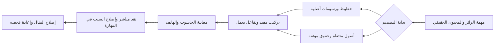

### من الصفر: مِداد

مساحة تحرير عربية RTL بهوية هادئة، وسياق واضح للأولوية على الهاتف، وإجراء ينقل المقال إلى المراجعة ويحدث التوصية والعدادات.

[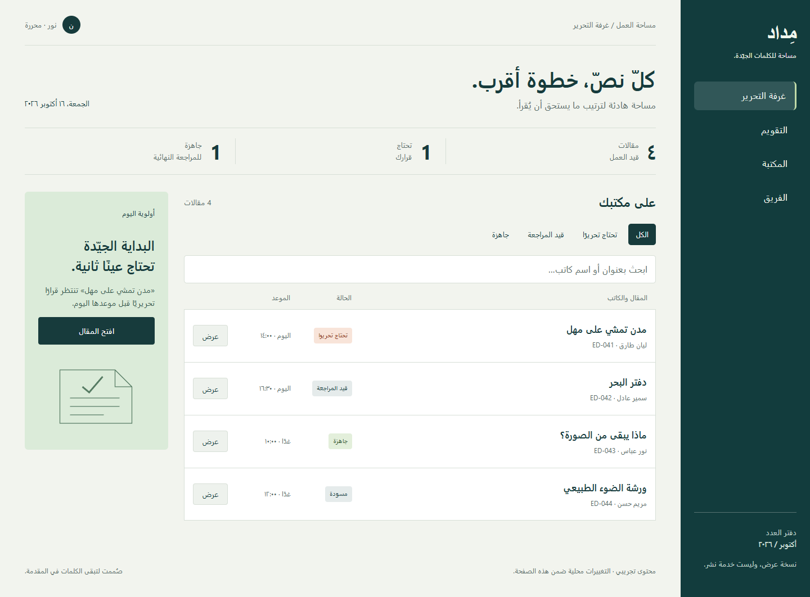](docs/showcase/midad/desktop.png)

[الهاتف](docs/showcase/midad/mobile.png) · [بعد الإجراء](docs/showcase/midad/changed.png) · [ملف التشغيل](docs/examples/midad/index.html)

### من الصفر: After Hours

برنامج سينمائي مفاهيمي بملصق طباعي برتقالي ورسومات أصلية، مع تبديل اليوم وقائمة عروض محلية تعمل. عولجت العناصر التي توحي بإجراء دون تنفيذه.

[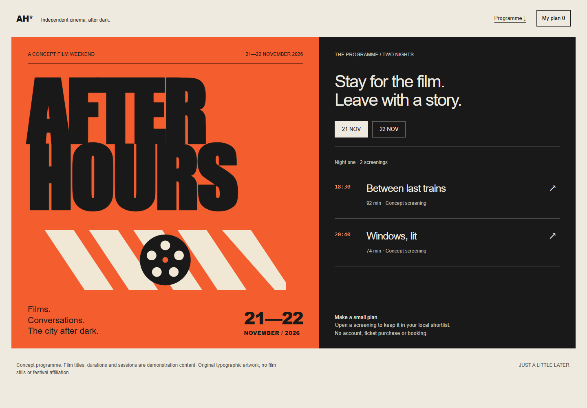](docs/showcase/after-hours/desktop.png)

[الهاتف](docs/showcase/after-hours/mobile.png) · [قائمتي](docs/showcase/after-hours/plan.png) · [ملف التشغيل](docs/examples/after-hours/index.html)

### بأصل منتقى: Field Notes

واجهة مشاهدة فنية حول لوحة فان غوخ «حقل قمح مع أشجار سرو» من مجموعة The Met المتاحة للملك العام. الهوية مشتقة من اللوحة، مع عرض كامل وتفصيل معلّم ونافذة مشاهدة. لا ادعاء بالانتساب للمتحف.

[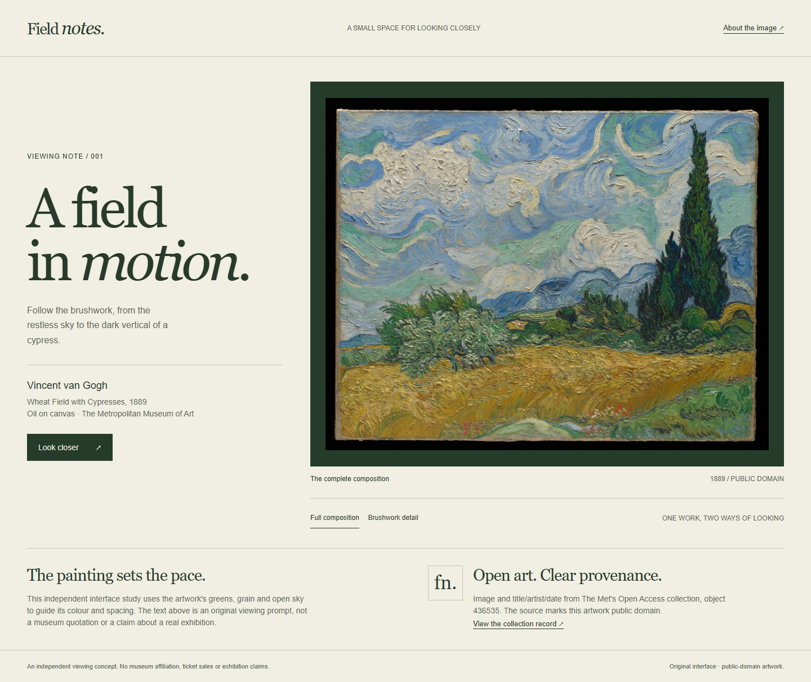](docs/showcase/field-notes/desktop.png)

[الهاتف](docs/showcase/field-notes/mobile.png) · [نافذة المشاهدة](docs/showcase/field-notes/viewer.png) · [ملف التشغيل](docs/examples/field-notes/index.html) · [المصدر والحقوق](docs/examples/ASSETS.md)

### بأصل منتقى: Still / Form

دراسة بصرية معمارية حول صورة Matt Boitor: شبكة مفتوحة وألوان معدنية تستجيب لقطر الدرابزين في الصورة. عرض كامل وتفصيل ونافذة دراسة؛ الصورة لا تُنسب كمشروع معماري للهوية الخيالية.

[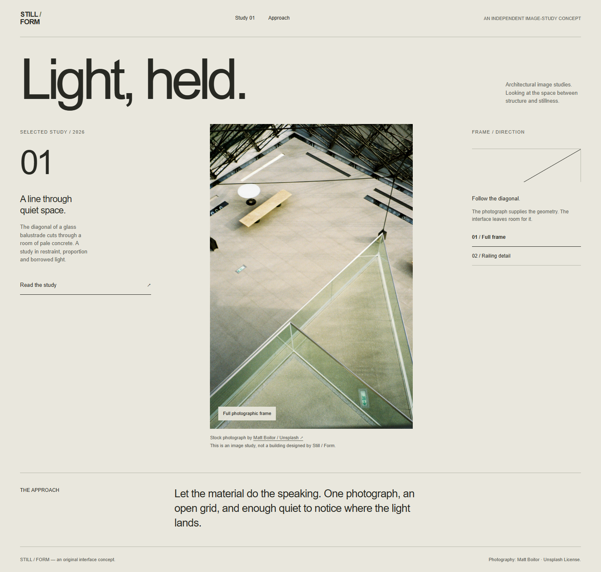](docs/showcase/still-form/desktop.png)

[الهاتف](docs/showcase/still-form/mobile.png) · [نافذة الدراسة](docs/showcase/still-form/study.png) · [ملف التشغيل](docs/examples/still-form/index.html) · [المصور والترخيص](docs/examples/ASSETS.md)

### مثالان سابقان: Night Ledger وSecond Seat

أرشيف رصد وعيادة إصلاح أثاث، برسومات برمجية ومحتوى تجريبي. هذه نتائج النسخة المرشحة **0.5.0**، ولها [مقارنة سابقة بنتائج مختلطة](docs/benchmarks/README.md)؛ لم تُعرض كاختبارات جديدة للتحديث الحالي.

| Night Ledger | Second Seat |
|---|---|
| [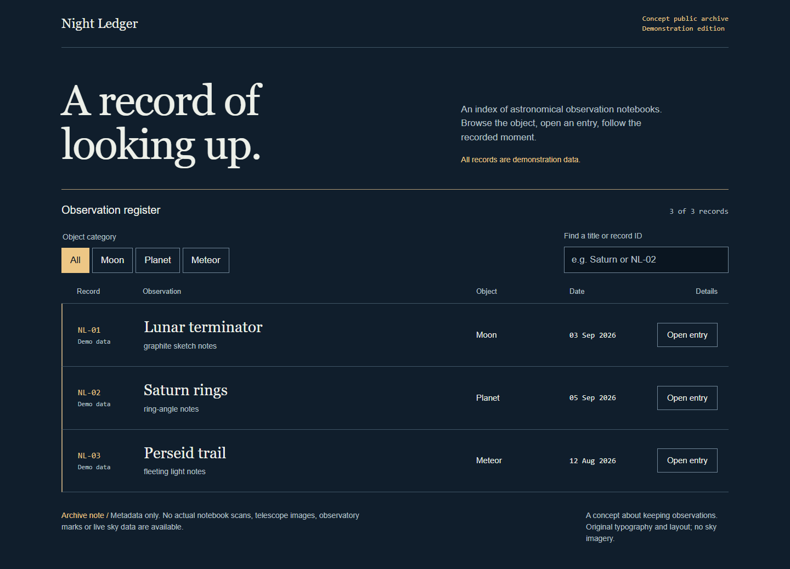](docs/benchmarks/artifacts/night-ledger-candidate-1440.png) | [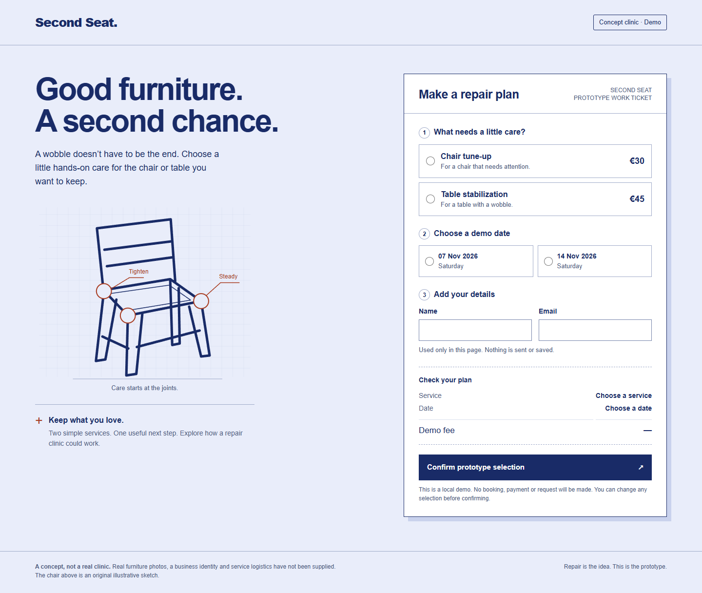](docs/benchmarks/artifacts/second-seat-candidate-1440.png) |
| [الهاتف](docs/benchmarks/artifacts/night-ledger-candidate-375.png) · [التشغيل](docs/benchmarks/artifacts/night-ledger-candidate.html) | [الهاتف](docs/benchmarks/artifacts/second-seat-candidate-375.png) · [التشغيل](docs/benchmarks/artifacts/second-seat-candidate.html) |

اضغط الصورة لعرضها بالحجم الكامل. لتشغيل مثال، نزّل المستودع وافتح ملف HTML محليًا؛ عارض الشفرة في GitHub لا يشغله. الأمثلة الأربعة الجديدة لا تحتاج خادمًا أو تحميل الصور من الشبكة. [مصادر الصور وشروط استخدامها](docs/examples/ASSETS.md).

</details>

## ما الذي تفعله؟

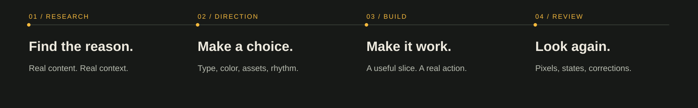

- تستخرج اتجاهًا من موضوع المشروع ودليله الحقيقي، بدل الاكتفاء بوصف مثل «فاخر» أو «حديث».
- تعاين مرجعًا أصليًا حين يحل سؤالًا مهمًا، ثم تحدد العلاقة التي ستُنقل وما لا يصح نسخه.
- تنفّذ جزءًا مفيدًا بمحتوى ممثل وإجراء حقيقي قبل استكمال السطح كله.
- تشخّص أنماط التصميم المتكررة دون حظر ألوان أو خطوط أو بطاقات يطلبها المستخدم.
- تهتم بحالات الخطأ والفراغ والاسترجاع وحفظ سياق المستخدم، لا بالصورة الأولى فقط.
- تفرّق بين الأصول الحقيقية والمفاهيمية والمفقودة، وتعيد تركيب الواجهة للهاتف وRTL.
- تستخدم الحركة و3D عندما يضيفان معنى، مع بديل ودورة حياة واضحة؛ السكون اختيار كامل القيمة.
- تفصل بين ما شوهد، وما اختُبر، وما بقي غير متحقق منه.

ابدأ من [التعليمات الأساسية](SKILL.md). تُقرأ المراجع بحسب القرار الجاري، لا باعتبارها قائمة قراءة إلزامية كاملة.

## التثبيت في Codex

اختر وجهة جديدة واحفظ أي نسخة موجودة بالاسم الداخلي نفسه:

```sh
git clone --depth 1 https://github.com/qwzx4893-stack/thunder-Skil.git ~/.agents/skills/immersive-web-studio
```

للتثبيت داخل مشروع، استخدم `.agents/skills/immersive-web-studio` في ذلك المشروع. راجع [وثائق Codex الرسمية](https://learn.chatgpt.com/docs/build-skills) إذا غيّر مضيفك أماكن الاكتشاف.

مثال طلب:

```text
استخدم $immersive-web-studio لتصميم هذا الأرشيف بمحتواه الحقيقي.
اجعل التصفح واضحًا على الهاتف، واحفظ نسب المعلومات إلى مصادرها، وراجع التنفيذ الفعلي.
```

للمضيفات الأخرى الداعمة لـ Agent Skills، نزّل ملف `.skill` من الإصدارات؛ هو أرشيف ZIP عادي. ضع الملفات في موقع المهارات الذي يدعمه المضيف، مع بقاء `SKILL.md` و`references/` و`scripts/` معًا. بيانات العرض في `agents/openai.yaml` اختيارية وقد يتجاهلها المضيف.

## ما قوة الأدلة؟

اجتازت أدوات التحقق المحلية **15 اختبارًا**، منها اختبارات متصفح فعلية وفحوص تغليف الإصدار. هذا يثبت سلوك الأدوات في الحالات المختبرة، ولا يثبت تفوق الذائقة أو مطابقة الوصول بالكامل.

المقارنة العملية للإصدار تستخدم خط أساس سابقًا ونسخة مرشحة على الطلبات نفسها. [تقرير النتائج](docs/benchmarks/README.md) يفصل السلوك الفعلي عن النقد البصري، ويحفظ الإخفاقات الأولى والإصلاحات وحدود القياس. لا ندّعي أن المهارة أفضل من جميع مهارات الشركات والمجتمع.

## أدوات اختيارية

```sh
npm run validate
npm run test:unit
npm test
npm run package
```

استخدم Node.js 22 أو أحدث للتطوير. يتطلب فحص المتصفح Playwright ومتصفح Chromium مثبتين؛ راجع [توثيق الأدوات](scripts/README.md). إذا لم يُضبط `BROWSER_EXECUTABLE` يُتجاوز اختبار المتصفح صراحةً، ولا يُحسب ناجحًا. تقوم CI بتجهيز متصفح معزول وتشغيل المجموعة كاملة.

تنتج أداة التغليف أرشيف `.skill` وبصمة SHA-256 من قائمة ملفات صريحة. لا تنشر كاش البحث المحلي أو مجلد Git أو بيانات المصادقة.

## المصادر والمساهمة

بُني التطوير على مصادر رسمية من OpenAI وAnthropic وAgent Skills، وأبحاث حديثة مع توضيح حدودها، ومعاينات مباشرة لمواقع أصلية. [سجل البحث](docs/research.md) يوضح ما استفدنا منه وما رفضناه. [حالات المواقع](references/observed-cases.md) ملاحظات مؤرخة، وليست مكتبة أنماط ثابتة أو ادعاء امتلاك برومبتات تلك المواقع.

رحّب بتحسين يحل إخفاقًا حقيقيًا بأصغر تعديل متماسك، مع حالة مضادة لا ينبغي أن تنطبق عليها القاعدة. اقرأ [دليل المساهمة](CONTRIBUTING.md) و[إرشادات الأمان](SECURITY.md).

الشفرة والأصول الأصلية بترخيص [MIT](LICENSE). صور الأمثلة الخارجية وظهورها في لقطات الشاشة تحتفظ [بحقوقها الموثقة](docs/examples/ASSETS.md) ولا يعاد ترخيصها باسم MIT. الإشارة إلى الشركات والمواقع لا تعني تأييدها للمشروع. المراجعة الجديدة نقد ذاتي من الوكيل الذي بنى الأمثلة، وليست تحكيمًا بشريًا مستقلًا أو إثباتًا للتفوق العام.

<p align="center"><br><sub>THUNDER SKIL · تصميم بقصد، وتنفيذ بدليل.</sub><br><a href="#">العودة إلى الأعلى ↑</a></p>
