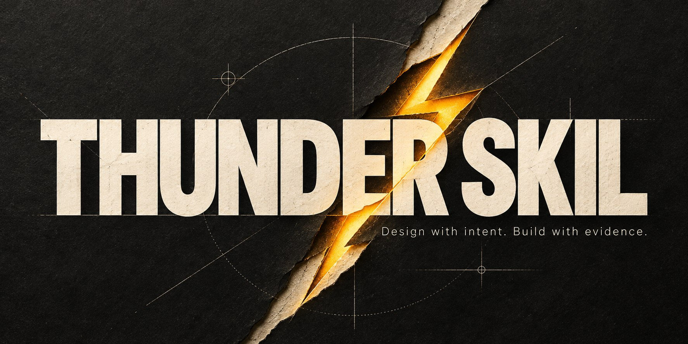

<p align="center">
  
</p>

<p align="center">
  <a href="https://github.com/qwzx4893-stack/thunder-Skil/actions/workflows/ci.yml"></a>
  <a href="https://github.com/qwzx4893-stack/thunder-Skil/releases"></a>
  <a href="LICENSE"></a>
  
</p>

<p align="center">
  <strong>Subject-led web design. Useful interfaces. Evidence you can inspect.</strong><br>
  <a href="#get-started">Get started</a> · <a href="docs/benchmarks/README.md">Test evidence</a> · <a href="docs/research.md">Research</a> · <a href="README.ar.md">العربية</a>
</p>

Thunder Skil is a portable agent skill for building and improving web interfaces with a reason for their composition. It connects the visitor's task, the subject's real evidence, assets, art direction, responsive behavior and rendered review.

A handcrafted product page, an Arabic operations tool and an exact reference implementation need different decisions. The skill routes them accordingly. It can choose stillness, a conventional control or a compact information model when that serves the work.

**Version:** 0.5.0 · **Runtime identifier:** `immersive-web-studio` · **No required API key, paid service or package runtime for the instructions.**

## What makes it useful

| Capability | What the agent actually does |
|---|---|
| Art direction from the subject | Connects real materials, records, people or product behavior to hierarchy and composition |
| Original-site research | Observes a matched precedent, extracts relationships, names what must not transfer and checks the adaptation |
| A useful first slice | Renders representative content and a meaningful action before elaborating an entire surface |
| Anti-template critique | Diagnoses default clusters, arbitrary emphasis and repetitive choreography while preserving explicit identity choices |
| Product behavior | Models state, action, recovery, persistence and context instead of styling only the happy path |
| Honest assets | Separates real, authorized conceptual and missing material; no invented proof or fake product photography |
| Responsive and RTL work | Recomposes order, density, crop and actions; checks real Arabic/mixed-script content where relevant |
| Purposeful immersion | Uses L0 stillness through L4 input/physics only when the medium adds value, with lifecycle and fallback |
| Bounded verification | Distinguishes screenshots, exercised tasks, automated smoke, visual judgment and field performance |

[Read the core workflow](SKILL.md) or explore the [dated original-site cases](references/observed-cases.md). The library is loaded by decision, not read in full at startup.

## Get started

Choose a new destination; preserve any existing installation with the same runtime name.

### Codex

For a user-wide installation:

```sh
git clone --depth 1 https://github.com/qwzx4893-stack/thunder-Skil.git ~/.agents/skills/immersive-web-studio
```

For a project-local installation, use `.agents/skills/immersive-web-studio` inside that project. These locations follow [official Codex skill documentation](https://learn.chatgpt.com/docs/build-skills). Optional `agents/openai.yaml` supplies the Thunder Skil display name and icon.

Then ask, for example:

```text
Use $immersive-web-studio to build a distinctive archive for these real records.
Preserve their provenance, make discovery useful on mobile, and verify the rendered result.
```

### Other Agent Skills hosts

Download the current `.skill` release (a standard ZIP) or clone the repository. Place the bundle in your host's supported skill directory with `SKILL.md`, `references/` and `scripts/` together. Keep the license and relative resources. Hosts may ignore optional Codex display metadata.

No install step is needed to read the instructions. Node.js is only for optional local helpers. Browser smoke additionally needs an installed Playwright module and Chromium browser; the skill does not install them automatically.

## Use it proportionally

- **New expressive site:** derive a direction, research a consequential unknown, build a useful slice and review the actual result.
- **Product workspace:** prioritize information, tasks and recovery. A marketing hero is optional.
- **Exact reference:** preserve the requested identity and fidelity.
- **Small correction:** inspect adjacent states, make the smallest coherent fix and check the affected views.
- **Review/planning only:** produce findings or decisions without silently implementing or claiming tests passed.

A stronger direction can require changing composition or acquiring a real asset. Adding gradients, 3D or more animation is not an automatic improvement.

## Evidence, with its limits

The repository publishes [test methodology and results](docs/benchmarks/README.md), reproducible helpers and relevant example artifacts.

**15 local verifier tests passed**, including a real browser fixture suite and release-packaging checks. That establishes behavior of the packaging/contrast/reflow helper checks in their tested environment. It does **not** certify visual taste or complete accessibility.

The current development comparison uses a previous-version baseline and fresh candidate runs on the same expressive-build and constrained-correction prompts. Actual task behavior, qualitative comparison, initial failures, repairs and unavailable coverage are reported separately. Read the report before interpreting a badge as a design-quality claim.

Thunder Skil is not proven universally better than Anthropic, UI/UX Pro Max or other community skills. No test score is presented as a percentage of aesthetic excellence.

## Verify and package

```sh
npm run validate
npm run test:unit
npm test
npm run package
```

`npm test` explicitly skips its browser fixture if `BROWSER_EXECUTABLE` is unset. To include it, configure an installed Chromium browser and Playwright as described in [scripts/README.md](scripts/README.md). CI installs an isolated Chromium and runs the full suite.

The optional smoke helper captures normal/reduced-motion screenshots at 320, 375, 768 and 1440 CSS pixels. It checks bounded DOM conditions and emits manual follow-ups. It does not click arbitrary controls, certify canvas pixels or establish field p75 performance.

`npm run package` builds a reproducible ZIP-format `.skill` and SHA-256 checksum from an explicit allowlist, excluding local caches, Git and credentials. The <8192-codepoint entrypoint/reference target is retained for compatibility with the original loader; it is not a universal skill specification.

## Inside the repository

```text
SKILL.md              Core routing and design-to-verification workflow
references/           Decision-specific craft, research, product, motion and QA
scripts/              Portable validator, bounded browser smoke and release packager
agents/               Optional Codex display metadata
evals/                Development prompts
docs/                 Research, asset provenance and public evaluation evidence
assets/               Original banner and icon
.github/              Pinned CI, issue/PR templates and dependency maintenance
```

See [research and adaptations](docs/research.md), [asset provenance](docs/asset-provenance.md), [changelog](CHANGELOG.md), [contribution guide](CONTRIBUTING.md) and [security guidance](SECURITY.md). Source-site images, private prompts and third-party prompt corpora are not redistributed.

## Contribute

Useful contributions start with a concrete design or implementation failure, a small coherent correction and an observable check. Include counterexamples where a proposed rule should not apply. Keep the skill flexible enough to respect real brands, scripts, tasks and reference choices.

[Open an issue](https://github.com/qwzx4893-stack/thunder-Skil/issues/new/choose) · [Read the contribution guide](CONTRIBUTING.md)

## License

[MIT](LICENSE). Research links acknowledge influence, not endorsement by the named organizations.
