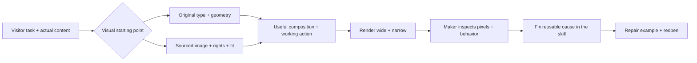

<p align="center">
  
</p>

<p align="center">
  <a href="https://github.com/qwzx4893-stack/thunder-Skil/actions/workflows/ci.yml"></a>
  <a href="https://github.com/qwzx4893-stack/thunder-Skil/releases"></a>
  <a href="LICENSE"></a>
  <a href="README.ar.md"></a>
</p>

<p align="center">
  <strong>Distinctive direction. Useful interfaces. Inspectable work.</strong><br><br>
  <a href="docs/expressive/README.md">Selected work</a> &nbsp; / &nbsp; <a href="#get-started">Get started</a> &nbsp; / &nbsp; <a href="docs/expressive/README.md">Read the critique</a> &nbsp; / &nbsp; <a href="README.ar.md">العربية</a>
</p>

Thunder Skil is a portable agent skill for building and improving web interfaces with a reason for their composition. It connects the visitor's task, the subject's real evidence, assets, art direction, responsive behavior and rendered review.

A handcrafted product page, an Arabic operations tool and an exact reference implementation need different decisions. The skill routes them accordingly. It can choose stillness, a conventional control or a compact information model when that serves the work.

**Version:** 0.6.1 · **Runtime identifier:** `immersive-web-studio` · **No required API key, paid service or package runtime for the instructions.**

Maintenance update: [reviewed craft guidance, repaired modal focus and current evidence](docs/fixes/README.md). This repair does not constitute a new design benchmark.

| Start building | Inspect the work | Understand the method | Explore the craft |
|:---|:---|:---|:---|
| [Download the skill ↗](https://github.com/qwzx4893-stack/thunder-Skil/releases/latest) | [Focused study & repairs ↗](docs/expressive/README.md) | [Core workflow ↗](SKILL.md) | [Research & sources ↗](docs/research.md) |

## Focused expressive study · A World Away

An archival story told through eight real NASA photographs, film with captions, a three-chapter mission sequence, an original schematic motion graphic and a working photographic viewer. **One focused case, personally reviewed and repaired by the making agent.** [Method, findings and limits →](docs/expressive/README.md)

[](docs/expressive/README.md)

<p align="center"><sub>Actual rendered captures · NASA media · Desktop, phone and interaction states · <a href="docs/expressive/apollo/ASSETS.md">Full credits</a></sub></p>

[Phone](docs/expressive/apollo/evidence/mobile.png) · [Mission chapter](docs/expressive/apollo/evidence/desktop-chapter-1.png) · [Motion graphic](docs/expressive/apollo/evidence/desktop-motion-graphic.png) · [Viewer](docs/expressive/apollo/evidence/mobile-viewer.png) · [Film](docs/expressive/apollo/evidence/mobile-film.png) · [Runnable source](docs/expressive/apollo/index.html) · [Personal critique and fixes](docs/expressive/README.md) · [Real asset credits](docs/expressive/apollo/ASSETS.md)

Run `node scripts/serve-example.mjs docs/expressive/apollo` and open the printed local URL for the complete experience, including native video captions. No build or remote runtime assets. Earlier simple examples below remain historical showcases, not evidence of award-level output.

[](docs/expressive/apollo/evidence/motion.webp)

<p align="center"><sub>In motion / sampled transitions from the actual page. This is a visual preview, not a performance measurement.</sub></p>

<details>
<summary><strong>Try the complete experience locally</strong></summary>

```sh
node scripts/serve-example.mjs docs/expressive/apollo
```

Open the printed local URL. The page includes film playback, captions, archive filtering and keyboard photo navigation. GitHub's source viewer does not run HTML.

</details>

## What makes it useful


| Capability | What the agent actually does |
|---|---|
| Art direction from the subject | Connects real materials, records, people or product behavior to hierarchy and composition |
| Original-site research | Observes a matched precedent, extracts relationships, names what must not transfer and checks the adaptation |
| A useful first slice | Renders representative content and a meaningful action before elaborating an entire surface |
| Anti-template critique | Diagnoses default clusters, arbitrary emphasis and repetitive choreography while preserving explicit identity choices |
| Product behavior | Models state, action, recovery, persistence and context instead of styling only the happy path |
| Honest assets | Separates real, authorized conceptual and missing material; no invented proof or fake product photography |
| Responsive and RTL work | Recomposes order, density, crop and actions; checks real Arabic/mixed-script content where relevant |
| Purposeful immersion | Uses L0 stillness through L4 input/physics only when the medium adds value, with lifecycle and fallback |
| Bounded verification | Distinguishes screenshots, exercised tasks, automated smoke, visual judgment and field performance |

[Read the core workflow](SKILL.md) or explore the [dated original-site cases](references/observed-cases.md). The library is loaded by decision, not read in full at startup.

## Design gallery

<details>
<summary>Open the six earlier 0.5.1 showcases and their review history</summary>

**Six earlier runnable concepts. Four 0.5.1 maker-reviewed cases. Two ways to start.** That historical round used direct main-agent critique, with a reusable skill correction after each case. No subagent critic or automated aesthetic score was used. The two 0.5.0 cases retain their separate comparison history. [Read the historical findings and limits →](docs/self-review-0.5.1.md)



### From scratch · Midad / مِداد

An Arabic RTL editorial desk. Quiet teal, readable article records, a priority that explains itself on mobile, and a working move-to-review action.

[](docs/showcase/midad/desktop.png)

[Phone](docs/showcase/midad/mobile.png) · [Changed state](docs/showcase/midad/changed.png) · [HTML](docs/examples/midad/index.html) · [Critique → skill repair](docs/self-review-0.5.1.md)

### From scratch · After Hours

A typographic film-weekend concept with original reel geometry, a two-day programme and an actual local shortlist. The poster and interaction have different jobs.

[](docs/showcase/after-hours/desktop.png)

[Phone](docs/showcase/after-hours/mobile.png) · [My plan](docs/showcase/after-hours/plan.png) · [HTML](docs/examples/after-hours/index.html) · [Critique → skill repair](docs/self-review-0.5.1.md)

### With sourced artwork · Field Notes

Van Gogh's *Wheat Field with Cypresses* sets the palette, pace and hierarchy. The complete painting, labeled brushwork crop and focused viewer preserve provenance. Public-domain image from The Met; no museum affiliation.

[](docs/showcase/field-notes/desktop.png)

[Phone](docs/showcase/field-notes/mobile.png) · [Artwork viewer](docs/showcase/field-notes/viewer.png) · [HTML](docs/examples/field-notes/index.html) · [Image rights/source](docs/examples/ASSETS.md#field-notes--public-domain-art) · [Critique → skill repair](docs/self-review-0.5.1.md)

### With sourced photography · Still / Form

A concrete-and-glass image study. Matt Boitor's portrait photograph supplies the diagonal, mineral colour and open grid. Full-frame/detail controls and a study dialog work. The fictional identity does not claim authorship of the building.

[](docs/showcase/still-form/desktop.png)

[Phone](docs/showcase/still-form/mobile.png) · [Open study](docs/showcase/still-form/study.png) · [HTML](docs/examples/still-form/index.html) · [Photo credit/license](docs/examples/ASSETS.md#still--form--licensed-stock-photography) · [Critique → skill repair](docs/self-review-0.5.1.md)

### Earlier cases · Night Ledger & Second Seat

An observation register and a furniture-repair clinic. Original code/typography and supplied demo records, with useful browsing or repair-intake behavior. These are the **0.5.0 candidate artifacts**, not newly generated 0.5.1 results; their [matched comparison](docs/benchmarks/README.md) reports mixed outcomes rather than universal wins.

| Night Ledger · observation register | Second Seat · repair clinic |
|---|---|
| [](docs/benchmarks/artifacts/night-ledger-candidate-1440.png) | [](docs/benchmarks/artifacts/second-seat-candidate-1440.png) |
| [Phone](docs/benchmarks/artifacts/night-ledger-candidate-375.png) · [HTML](docs/benchmarks/artifacts/night-ledger-candidate.html) | [Phone](docs/benchmarks/artifacts/second-seat-candidate-375.png) · [HTML](docs/benchmarks/artifacts/second-seat-candidate.html) |

Click any screenshot for its full size. To run a case, clone/download and open its HTML locally; GitHub's source viewer does not execute it. The four new cases work without a server or image network access. Their image rights are documented in the [asset ledger](docs/examples/ASSETS.md).

</details>

## Get started

Choose a new destination; preserve any existing installation with the same runtime name.

### Codex

For a user-wide installation:

```sh
git clone --depth 1 https://github.com/qwzx4893-stack/thunder-Skil.git ~/.agents/skills/immersive-web-studio
```

For a project-local installation, use `.agents/skills/immersive-web-studio` inside that project. These locations follow [official Codex skill documentation](https://learn.chatgpt.com/docs/build-skills). Optional `agents/openai.yaml` supplies the Thunder Skil display name and icon.

Then ask, for example:

```text
Use $immersive-web-studio to build a distinctive archive for these real records.
Preserve their provenance, make discovery useful on mobile, and verify the rendered result.
```

### Other Agent Skills hosts

Download the current `.skill` release (a standard ZIP) or clone the repository. Place the bundle in your host's supported skill directory with `SKILL.md`, `references/` and `scripts/` together. Keep the license and relative resources. Hosts may ignore optional Codex display metadata.

No install step is needed to read the instructions. Node.js is only for optional local helpers. Browser smoke additionally needs an installed Playwright module and Chromium browser; the skill does not install them automatically.

## Use it proportionally

- **New expressive site:** derive a direction, research a consequential unknown, build a useful slice and review the actual result.
- **Product workspace:** prioritize information, tasks and recovery. A marketing hero is optional.
- **Exact reference:** preserve the requested identity and fidelity.
- **Small correction:** inspect adjacent states, make the smallest coherent fix and check the affected views.
- **Review/planning only:** produce findings or decisions without silently implementing or claiming tests passed.

A stronger direction can require changing composition or acquiring a real asset. Adding gradients, 3D or more animation is not an automatic improvement.

## Evidence, with its limits

The repository publishes [test methodology and results](docs/benchmarks/README.md), reproducible helpers and relevant example artifacts.

The [0.5.1 self-review](docs/self-review-0.5.1.md) adds four sequential maker-reviewed examples and narrow corrections for observed causes: lost mobile context, stale recommendations, misleading controls, delayed subject matter, image delivery and decorative collisions. Desktop/mobile/state captures and concrete replay observations are public. This is self-review by the making agent, not independent human validation or a controlled estimate of skill efficacy.

**15 local verifier tests passed**, including a real browser fixture suite and release-packaging checks. That establishes behavior of the packaging/contrast/reflow helper checks in their tested environment. It does **not** certify visual taste or complete accessibility.

The earlier development comparison used a previous-version baseline and fresh candidate runs on the same expressive-build and constrained-correction prompts. Actual task behavior, qualitative comparison, initial failures, repairs and unavailable coverage are reported separately. The focused 0.6.0 study is a maker-reviewed case. Read the reports before interpreting a badge as a design-quality claim.

Thunder Skil is not proven universally better than Anthropic, UI/UX Pro Max or other community skills. No test score is presented as a percentage of aesthetic excellence.

## Verify and package

```sh
npm run validate
npm run test:unit
npm test
npm run package
```

`npm test` explicitly skips its browser fixture if `BROWSER_EXECUTABLE` is unset. To include it, configure an installed Chromium browser and Playwright as described in [scripts/README.md](scripts/README.md). CI installs an isolated Chromium and runs the full suite.

The optional smoke helper captures normal/reduced-motion screenshots at 320, 375, 768 and 1440 CSS pixels. It checks bounded DOM conditions and emits manual follow-ups. It does not click arbitrary controls, certify canvas pixels or establish field p75 performance.

`npm run package` builds a reproducible ZIP-format `.skill` and SHA-256 checksum from an explicit allowlist, excluding local caches, Git and credentials. The <8192-codepoint entrypoint/reference target is retained for compatibility with the original loader; it is not a universal skill specification.

## Inside the repository

| Design decisions | Evidence & examples | Project maintenance |
|:---|:---|:---|
| [Core instructions](SKILL.md) | [Selected study](docs/expressive/README.md) | [Changelog](CHANGELOG.md) |
| [Expressive direction](references/expressive-direction.md) | [Earlier gallery](#design-gallery) | [Contribute](CONTRIBUTING.md) |
| [Motion system](references/motion-system.md) | [Comparison reports](docs/benchmarks/README.md) | [Report a problem](https://github.com/qwzx4893-stack/thunder-Skil/issues/new/choose) |

<details>
<summary>Repository map</summary>

```text
SKILL.md              Core routing and design-to-verification workflow
references/           Decision-specific craft, research, product, motion and QA
scripts/              Portable validator, bounded browser smoke and release packager
agents/               Optional Codex display metadata
evals/                Development prompts
docs/                 Research, asset provenance and public evaluation evidence
assets/               Original banner and icon
.github/              Pinned CI, issue/PR templates and dependency maintenance
```

</details>

See [research and adaptations](docs/research.md), [asset provenance](docs/asset-provenance.md), [changelog](CHANGELOG.md), [contribution guide](CONTRIBUTING.md) and [security guidance](SECURITY.md). Research-site images, private prompts and third-party prompt corpora are not redistributed. The two explicitly sourced showcase images are bundled under their documented original terms.

## Contribute

Useful contributions start with a concrete design or implementation failure, a small coherent correction and an observable check. Include counterexamples where a proposed rule should not apply. Keep the skill flexible enough to respect real brands, scripts, tasks and reference choices.

[Open an issue](https://github.com/qwzx4893-stack/thunder-Skil/issues/new/choose) · [Read the contribution guide](CONTRIBUTING.md)

## License

[MIT](LICENSE) for code and original project assets. External media/fonts and their appearances in screenshots retain the [documented source rights](docs/asset-provenance.md). Research links acknowledge influence, not endorsement by the named organizations.

<p align="center"><br><sub>THUNDER SKIL · Design with intent. Build with evidence.</sub><br><a href="#">Back to top ↑</a></p>
